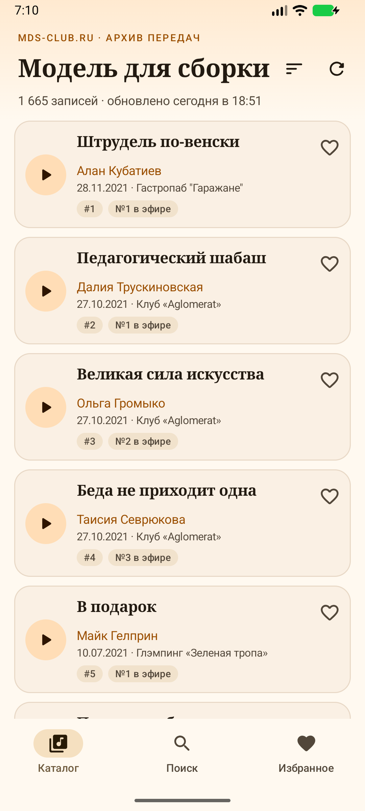
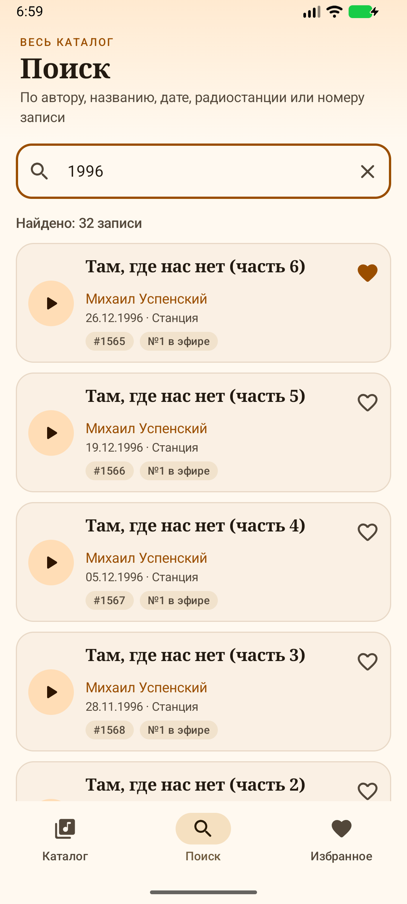
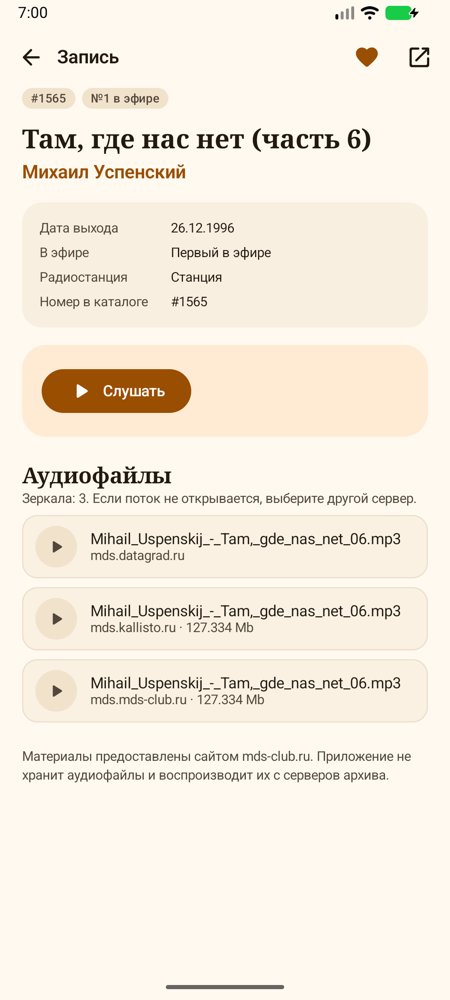
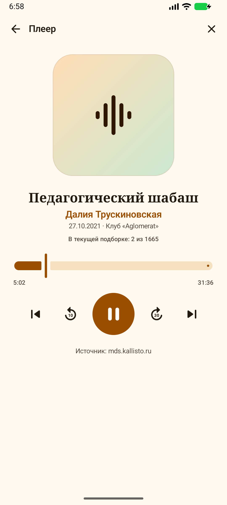

# МДС Плеер

Неофициальный Android-клиент архива радиопередачи **«Модель для сборки»** на сайте [mds-club.ru](http://mds-club.ru/cgi-bin/index.cgi?r=84&lang=rus).

Приложение загружает весь каталог (1665 записей), позволяет искать по автору, названию, дате, радиостанции и номеру, сохранять избранное и слушать записи в фоне с экрана блокировки.

| Каталог | Поиск | Запись | Плеер |
|---|---|---|---|
|  |  |  |  |

## Возможности

- **Полный каталог.** Все страницы архива загружаются один раз и кэшируются на диск. При следующем запуске список доступен сразу, в том числе без интернета.
- **Локальный поиск.** Ищет по автору, названию, дате, радиостанции, номеру записи и номеру в эфире. Несколько слов в запросе ищутся одновременно (логика «И»), есть подсказки и сортировка по релевантности.
- **Избранное.** Записи сохраняются в `SharedPreferences` и доступны на отдельном экране.
- **Подробная страница.** Дата, номер в каталоге, номер в эфире, рецензия и список зеркал аудио.
- **Плеер.** Воспроизведение в фоне, уведомление и экран блокировки, пауза/перемотка на 10 и 30 секунд, переход к следующей/предыдущей записи из текущей подборки.
- **Зеркала и отказоустойчивость.** Можно вручную выбрать сервер; если поток не открывается, плеер автоматически пробует следующее зеркало.
- **Тёмная и светлая темы.** Тёплая палитра в духе сайта, Material 3 без динамических цветов.

## Скриншоты

Все изображения находятся в [`docs/screenshots`](docs/screenshots). Сняты на эмуляторе Android с реальными сетевыми данными. Дополнительно: [избранное](docs/screenshots/favorites.png) и [тёмная тема](docs/screenshots/dark.png).

## Как это работает

### Каталог и кэш

1. Загружается первая страница каталога, из неё берётся общее число записей (`#roller_num`).
2. Остальные страницы (по 50 записей) скачиваются параллельно, не более 6 запросов одновременно.
3. Результат сохраняется в `filesDir/catalog.json` атомарно (через временный файл) вместе с флагом полноты и временем обновления.
4. Кэш считается свежим 12 часов. Если загрузка не удалась, показываются ранее сохранённые данные с сообщением об ошибке.
5. Подробности записи кэшируются отдельно на 30 дней в `filesDir/details/<id>.json`.

### Поиск

Поиск полностью локальный: после синхронизации в памяти находится весь каталог. Строка нормализуется (нижний регистр, `ё → е`, неразрывные пробелы), запрос разбивается на слова, и запись должна содержать все слова. Результаты сортируются по релевантности: совпадение в начале названия, затем в начале автора, затем вхождение в название/автора, затем остальные поля.

Это удобнее поиска на сайте: там доступен только поиск по дате, а локальный индекс ищет по всем полям сразу.

### Плеер

- `androidx.media3` ExoPlayer + `MediaSessionService`.
- Ссылки на аудио извлекаются со страницы записи (`#player object[data]`, `param[name=movie]`) и из таблицы зеркал `#catalogtable`.
- FTP-ссылки отбрасываются, HTTP-ссылки дедуплицируются.
- При ошибке воспроизведения автоматически выбирается следующее зеркало.
- Состояние плеера живёт в `Application`, поэтому музыка не прерывается при переходе между экранами.
- На Android 13+ приложение запрашивает разрешение на уведомления (на воспроизведение отказ не влияет).

### Разбор HTML

Сайт отдаёт страницы в **windows-1251** и работает только по HTTP. Поэтому:

- байты ответа декодируются в `windows-1251` до передачи в Jsoup;
- в манифесте включён `usesCleartextTraffic="true"`;
- HTTPS для сайта и зеркал не используется, так как он не поддерживается.

Основные селекторы:

| Данные | Источник |
|---|---|
| Строки каталога | `#catalogtable tbody tr` |
| Общее число записей | `#roller_num` |
| Заголовок и поля записи | `#attachtitle` |
| Рецензия | `#review` |
| Плеер | `#player object[data]`, `#player param[name=movie]` |
| Зеркала | `#catalogtable tbody tr` (4-я колонка) |

У нескольких старых записей нет ссылки на страницу. Для них создаётся синтетический id `xNNN`; такие записи видны в каталоге, но помечены как недоступные для воспроизведения.

## Стек

| Компонент | Версия |
|---|---|
| Kotlin | 2.2.10 |
| Jetpack Compose BOM | 2026.02.01 |
| Material 3 | из Compose BOM |
| Navigation Compose | 2.10.2 |
| Media3 (ExoPlayer, Session) | 1.11.1 |
| OkHttp | 4.12.0 |
| Jsoup | 1.18.3 |
| Kotlin Coroutines | 1.10.2 |
| minSdk / targetSdk / compileSdk | 24 / 37 / 37 |
| Gradle / AGP | 9.6.0 / 9.4.1 |

## Структура проекта

```text
app/src/main/java/com/mds/player/
├── MainActivity.kt              # Единственная Activity, запрос разрешения на уведомления
├── MdsApplication.kt            # Создание репозитория и PlaybackManager
├── MainViewModel.kt             # Состояние экранов, поиск, избранное, очередь
├── MdsApp.kt                    # Навигация, нижняя панель, мини-плеер
├── data/
│   ├── CatalogModels.kt         # Модели, сортировка и чистые функции поиска
│   ├── CatalogParser.kt         # Разбор каталога и страницы записи (Jsoup)
│   ├── CatalogJson.kt           # Сериализация кэша и избранного в JSON
│   ├── MdsClient.kt             # OkHttp-клиент и URL сайта
│   └── MdsRepository.kt         # Синхронизация, дисковый кэш, избранное
├── playback/
│   ├── PlaybackService.kt       # MediaSessionService + ExoPlayer
│   └── PlaybackManager.kt       # MediaController, состояние плеера, зеркала
└── ui/
    ├── CatalogScreen.kt         # Каталог и сортировка
    ├── SearchScreen.kt          # Поиск и подсказки
    ├── FavoritesScreen.kt       # Избранное
    ├── DetailScreen.kt          # Запись, рецензия, зеркала
    ├── PlayerScreen.kt          # Полноэкранный плеер
    ├── Components.kt            # Общие карточки и элементы
    ├── Format.kt                # Форматирование даты и длительности
    └── theme/                   # Цвета, типографика, темы
```

Тесты находятся в `app/src/test/java/com/mds/player/data/` и покрывают парсер, поиск/сортировку и JSON-сериализацию.

## Сборка и запуск

### Требования

- Android Studio с установленным **Android SDK Platform 37**;
- **JDK 17+** (подойдёт JBR из Android Studio);
- интернет для первой синхронизации каталога.

### Команды

```bash
# Укажите путь к SDK, если он не задан в local.properties или ANDROID_HOME
echo "sdk.dir=/path/to/Android/Sdk" > local.properties

# Тесты и debug-сборка
./gradlew :app:testDebugUnitTest :app:assembleDebug --console=plain

# APK
# app/build/outputs/apk/debug/app-debug.apk

# Установка на подключённый эмулятор или телефон
adb install -r app/build/outputs/apk/debug/app-debug.apk
```

Если Gradle не находит Java, укажите `JAVA_HOME`, например:

```bash
JAVA_HOME="$HOME/android-studio/jbr" ./gradlew :app:assembleDebug --console=plain
```

### Тесты

```bash
./gradlew :app:testDebugUnitTest --console=plain
```

14 модульных тестов: разбор каталога и страницы записи, поиск и сортировка, сериализация кэша и избранного.

## Ограничения

- Приложение неофициальное и зависит от текущей вёрстки сайта. Если mds-club.ru изменит HTML, парсер потребует обновления.
- Сайт и зеркала работают по HTTP: трафик не шифруется. Это ограничение источника, а не приложения.
- Аудио не скачивается: записи воспроизводятся потоком и недоступны офлайн.
- Без сети доступны только ранее загруженный каталог, избранное и кэш страниц записей; новые записи и аудио не загрузятся.
- У части старых записей нет страницы с аудиофайлами — они помечены в интерфейсе.
- Поле «Радиостанция» на сайте у многих записей содержит буквально «Станция»; приложение показывает значение как есть.

## Правовая информация

Это неофициальный клиент, созданный в учебных целях. Он не связан с редакцией «Модели для сборки», сайтом mds-club.ru или правообладателями.

Все тексты, рецензии, аудиозаписи и товарные знаки принадлежат их авторам и правообладателям. Приложение не хранит и не распространяет аудиофайлы: оно только воспроизводит публично доступные потоки с серверов архива. Используйте приложение для личного ознакомления и поддерживайте авторов и проект удобным для вас способом.
